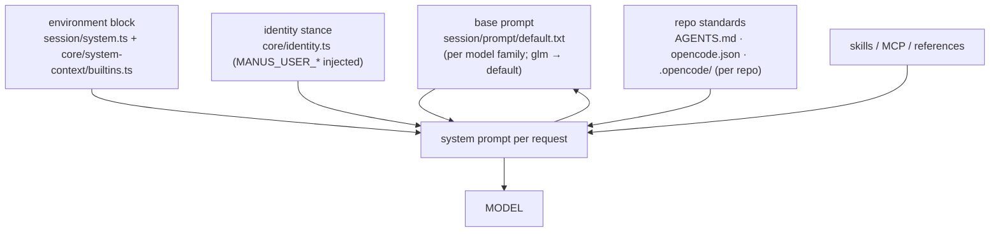

# ADR-0008.5: The prompts are the product's voice

Status: accepted · Date: 2026-10-20
Amends: ADR-0006 (the loop's doctrine — unchanged; its _voice_ to the dev is what moves)
Relates to: ADR-0015-era identity seam (manus-dei), ADR-0008 (roles), ADR-0009 (the roster the environment announces)
Fixes: the re-greeting after a phantom session (corpus), the prose-as-verification
defect (corpus: two wasted dev rounds + a judge finding), the command-line-assistant
stance fighting autonomous runs, and the prompt's routing to anomalyco infrastructure (F0 rule)

The number is decimal on purpose: this decision belongs between ADR-0008 (roles as
sessions) and ADR-0009 (workspace as repos) — it was found in that order and its
environment line anticipates 0009 — but 0009 had already merged, and renumbering a
merged record is worse than a decimal. Read "0008.5" as "the prompt pass that belongs
after the roles, before the roster."

## Context

### Three layers speak to the model, and each had the wrong accent

1. **The base prompt was a command-line chat assistant's.** Written for `opencode`
   in a terminal: _"fewer than 4 lines"_, monospace rationale, _"be proactive
   only when asked"_, _"NEVER commit unless the user explicitly asks"_, _"DO NOT
   ADD ANY COMMENTS unless asked"_ — and three routes to another company's
   infrastructure (_"You are opencode"_, `github.com/anomalyco/opencode/issues`,
   `opencode.ai` docs).
2. **The environment block asked the wrong question.** `Is directory a git repo:
yes/no` is a lie in both workspace shapes the product summons: a wrapper root
   says "yes" and hides the real repos as gitlinks; a plain root says "no" with
   three repos beside it. It answers the _snapshot service's_ old constraint, not
   the model's need to know what it is working on.
3. **The stance was a greeting plus a pointer.** It said "read this repository's
   own standards" (singular), and "greet {name} by name" unconditionally — a
   re-sent system prompt made a continuing session greet again after a phantom
   session was minted (found in the wallpaper run; embedded in the corpus).

### The receipts, from the run that exercised them

- A dev finished, ordered the dev server down, and could not commit its own
  round without apologising to the base prompt's "never commit" rule — then
  committed anyway per the repo's standards.
- Two dev rounds were burned by `verification` written as prose ("…npm run
  build, plus browser screenshots of…"): the gate ran it as a shell command.
  A judge later named the swallowed screenshot clause as a finding.
- QA's round-1 death by `pkill -9 -f 'next'` — broad pattern kills matching the
  killer's own command line — is a process-hygiene gap in every prompt layer.
- The re-greeting/phantom-session pair: the stance's unconditional greet.

## Decision

### A. The base prompt becomes the product's (session/prompt/default.txt)

1. **Identity and routing.** "You are Manica Dei's engineering agent: an
   autonomous software engineer working in a sandboxed workspace on behalf of
   one person." No anomalyco issue/docs/URL routing; `/help` stays local.
2. **Autonomy is the default after authorization.** _"The human's authorization
   of the goal is the ask. Once authorized, pursue the work — plan, implement,
   verify, report — and do not wait for turn-by-turn permission. Ask the human
   only at the two ends: what the work is, and when the contract's stop
   condition is reached."_
3. **The artifact, not the claim.** _"Your word is not evidence. … the loop runs
   [the verification] too, and a fresh-context reviewer attacks the artifact.
   Leave the work in the workspace for that review."_
4. **Commits follow the artifact rule.** Commits are not required and not
   forbidden: _"Leave your work in the workspace; that state is the artifact …
   uncommitted included. Commit only when the person asks, or when the
   repository's own standards make it the rule."_ (The base prompt's absolute
   "NEVER commit" is gone; the repo's standards — how the corpus's branch commit
   actually happened — are admitted.)
5. **The workspace is a set of repos.** _"The workspace holds the repositories
   you are meant to work on, plus the workspace's own AGENTS.md. Standards live
   in each repository … Work may span several repositories; the review sees all
   of them."_
6. **Process hygiene is a rule, not advice.** _"Stop [processes] by PID when you
   are done, never with broad pattern kills that can match your own shell, and
   leave the person's own servers alone."_ (The QA death, generalized.)
7. **Concision, re-scoped.** Short chat replies stay; _"reports the work
   requires — scoping a contract, summarising a finished round — are as complete
   as the work needs"_. The CLI/monospace rationale is dropped.
8. **Comments are style, not prohibition.** _"Do not add noise comments.
   Document the non-obvious — why a decision was made — where the surrounding
   code does it."_

### B. The environment block announces the roster (both assembly paths)

`session/system.ts` (legacy) and `core/system-context/builtins.ts` (v2) both:

- replace `Is directory a git repo: yes/no` with
  `Workspace repos: app (/workspace/app) · billing (/workspace/billing)` —
  depth-1 scan for `.git`, root included only when the location says it is a
  repo, `node_modules` skipped; `(none detected)` otherwise;
- add `Runtime: sandboxed container; the workspace persists, the operating
system does not.` — the contract the agent needs to prefer project-local
  installs.

The scan is a _display_ truth until ADR-0009 phase 1's authoritative roster
(declared ∪ round-living discovery) replaces it; the line then reads from the
same port the snapshots use without changing its wording.

### C. The stance is scoping discipline (core/identity.ts)

1. **First-exchange greeting only**: _"On your first exchange in this session
   greet {name} by name. If {name} has already been greeted in this session, do
   not greet again."_ (Stateless-safe: the model reads the transcript it holds.)
2. **Contract-as-spec, in the stance**: outcome in testable terms; verification
   as _"one exact command line the loop runs verbatim — prose, commas joining
   clauses, or 'plus a browser check' belong in constraints, not verification"_;
   constraints and boundaries naming the repos; `stop_when` naming the business
   decisions; _"Propose it for {name} to confirm before running unattended;
   never authorize yourself."_
3. **The loop narrated once** (so the dev does not argue with its harness):
   gates run the verification, QA attacks the artifact, a judge rules against
   the contract, _"Nobody here signs their own work — including you. Leave
   evidence, not claims."_
4. **The multi-repo shape announced**: _"The workspace may hold several
   repositories; the work may span them, and the review sees all of them."_

### D. The goal tool's verification bullet is a command, not a role

`tool/goal.txt`: _"It must be **one exact shell command line** … Prose makes it
unrunnable — a clause joined with a comma, or a 'plus a browser check' that names
work instead of running it, belongs in constraints, never here."_ The parser
hardening that backs this with a refusal is a separate commit (the gate-prose
fix); the prompt states the requirement now because the corpus proves a
reasonable model will otherwise write a sentence and mean well.

## Deliberately not changed

- **QA's brief and the judge's four verdicts.** Both passed live fire; only
  their _material_ changes under ADR-0009. Their wording stays.
- **The commit authority stays human/standard.** No prompt orders the agent to
  commit; the artifact rule governs.
- **Skills, MCP, references, compaction/summary/title/explore prompts.** Out of
  this pass.
- **The product name.** "Manica Dei's engineering agent" is adopted here; if a
  separate codename is chosen before release, it replaces one string in one
  file.

## Consequences

- Sessions summoned on the next pin demonstrate: an agent that does not fight
  its own autonomy, does not apologise for a normal commit, cannot be nudged by
  its own "be less proactive" instruction after authorization, writes runnable
  verifications, and knows the workspace is plural.
- The environment line changes in both assembly paths, so a model gets the same
  facts whichever runner serves the request.
- Prompt text is English by design (model-facing, not a UI string — the i18n
  law governs the app's copy, not system prompts).
- Behavioural deltas are measurable in the corpus: the next live run's QA round
  count, gate attempts, and regeneration of the prose-verification defect become
  eval observations.

## Verification

- `core/test/identity.test.ts`: 10 pass — the stance pins (first-exchange only;
  spec writing; the loop narration; multi-repo) replace the old pins.
- `core/test/system-context/builtins.test.ts`: 4 pass — the roster line replaces
  the git-bit line, runtime contract added.
- Workspace typecheck: 0 TS errors.
- The goal suites pass unchanged (the loop's code path is untouched; only the
  prompt text it ships moves).
