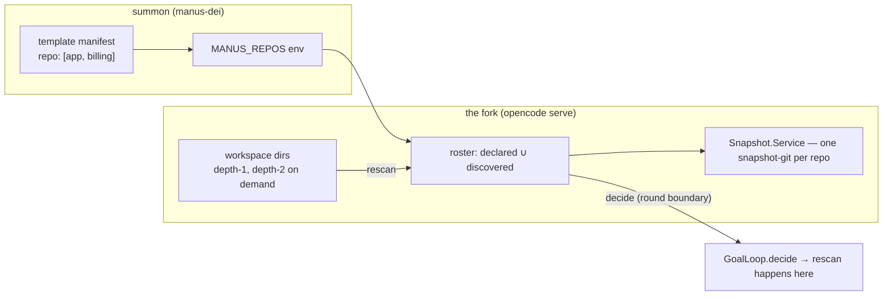
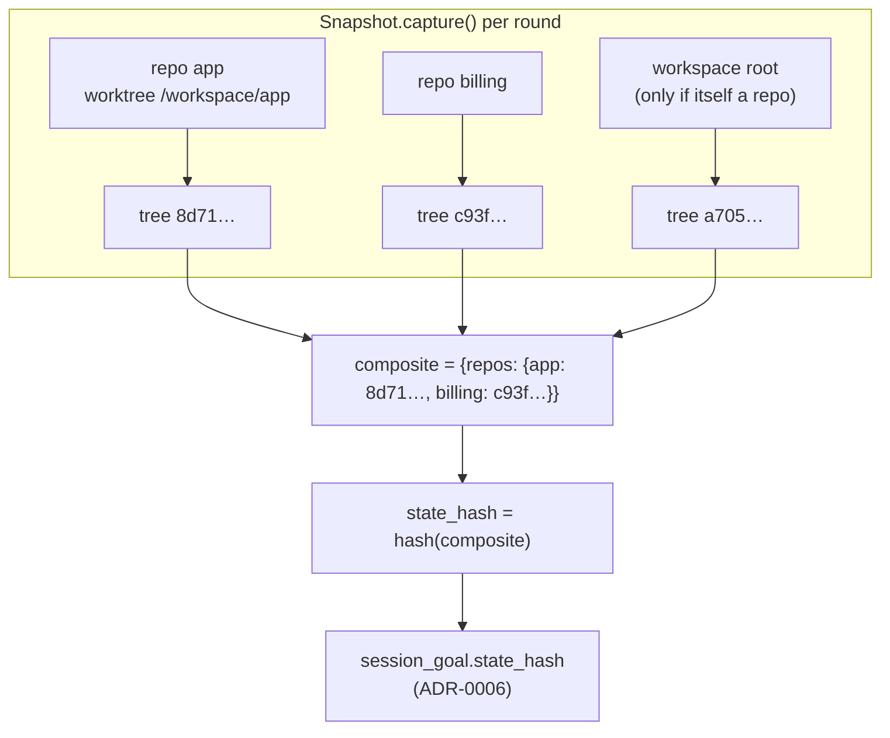
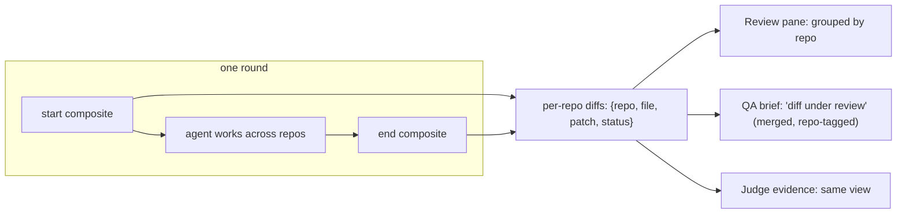
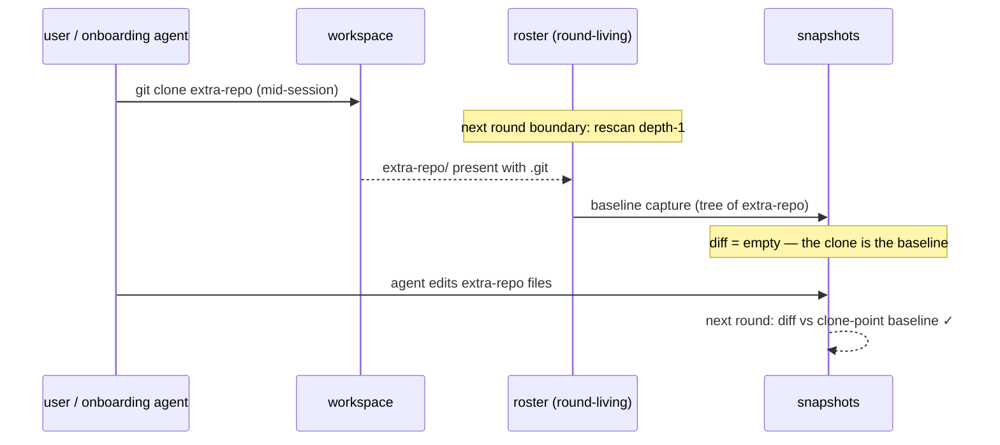

# ADR-0009: The workspace is a set of repositories

Status: accepted · Date: 2026-10-20
Amends: ADR-0006 (the goal loop's state binding — unchanged in promise, changed in substrate)
Fixes: the summoned-workspace snapshot deadlock (`goal-loop.ts:198`, "no workspace state
to bind a review to") and the git-init-on-root bandaid the templates grew for it
Relates to: manus-dei PLAN §5 (summon) and §4 (template manifest — the `repo:` list);
ADR-0007 (the layer-build discovery lesson that this ADR refuses to repeat); the live
corpus `evals/goal-loop/runs/agent-db-live-2026-10-17/`

## Context

### The workspace the product actually summons

manus-dei's template manifests declare a **list** of repos, and summon has seeded
them as sibling folders under the workspace root since phase 1
(`MANUS_REPOS` env, entrypoint `git clone --depth 1` for each):

```text
/home/ubuntu/workspace                ← the agent's cwd; the "project directory"
├── AGENTS.md                         ← the workspace's own standard (layer: repo standard)
├── app/                              ← repo 1 (a full git repo of its own)
│   ├── .git
│   ├── components/…
│   └── package.json
├── billing/                          ← repo 2 — the shape manifests already allow
│   └── .git
└── .opencode/ (scratchpads, probes)  ← workspace-side, never a repo
```

The agent is expected to develop on **all of them simultaneously** ("the agent does
dev on all of them at once"). Two- and three-repo templates are
already-provisioned shapes.

One summoned workspace from the corpus arrived with a _third_ arrangement: a
wrapper `.git` at the root, created by hand after summon as a bandaid to make the
snapshot service see _a_ repo at all.

### What the harness assumes today

Every layer below assumes **exactly one repository** — the project directory's —
and holds it for the whole server lifetime:

```ts
// core/src/snapshot.ts — the layer body
const source = yield * git.repo.discover(location.project.directory) // ← once, at layer build
const enabled = Effect.fnUntraced(function* () {
  if (location.vcs?.type !== "git") return false // ← the root must be a repo
  return Config.latest(yield* config.entries(), "snapshots") !== false
})
```

Consequences, each with a receipt from the corpus:

1. **Root not a repo ⇒ nothing binds.** The summoned workspace's agent cwd
   (`/workspace`) is deliberately not a git repo; `locate.vcs` is non-git, capture
   is disabled, every `step-finish` went out snapshot-less — 149/149 in the
   tested session — and the goal loop stopped honestly at `goal-loop.ts:198`
   ("no workspace state to bind a review to"). The loop's heart was starved by
   the workspace _shape_, not by any loop defect.
2. **Root is a repo ⇒ the inner repos go blind.** With the bandaid's wrapper
   repo, `capture()` snapshots the wrapper's tree, and the inner repo appears as
   a **gitlink** — `app (modified, +1 -1)` — a pointer change with zero readable
   content. QA's own words: _"app is a submodule; the real diff lives inside it.
   Let me inspect the submodule's changes"_ — and it then spent its turns
   re-deriving the diff (`git diff 736f20a..HEAD -- components/…`) the harness
   should have handed it.
3. **Discovery is boot-frozen.** A repo that appears after the server boots is
   invisible forever: `source` resolved once at layer build, `enabled()` reads
   the location's cached vcs type. The same class of bug ADR-0007 fixed for the
   browser, persisting in the snapshot layer.

### Constraints

- **At least one repo per workspace, guaranteed by the manifest** (for now; a
  future repo→workspace template onboarding flow may craft custom templates —
  out of scope until it exists).
- **No seam widening.** `MANUS_REPOS` stays the only manus↔fork git contract; it
  is already the entrypoint's input. The repository list is env transport, like
  identity (`MANUS_USER_*`, ADR-015's seam law), not a new integration.
- **ADR-0006's promises hold unchanged.** "The goal stops rather than pass
  unaudited"; the state hash binds a _round_; QA is a fresh-context reviewer;
  the judge is tool-less. This ADR changes the _substrate_ the hash binds to,
  never the contract's vocabulary.
- Depth: nested repos are tracked to **depth 2** (workspace/app/packages/foo).
  `node_modules/` and friends never recurse. Unbounded discovery across
  vendored trees is not a shape this architecture survives by accident.

## Decision

### 1. The roster is declared data, re-checked every round

The workspace's repo set is the union of:

- **the declared roster** — the manifest's repo list, at summon time in
  `MANUS_REPOS` (existing env; without schema changes), and
- **the discovered roster** — `git.repo.discover` against each depth-1 (and the
  declared repos' depth-2 children on demand) workspace entry, **re-run at each
  round boundary** rather than resolved once at boot.



Rescanning at the round boundary is the load-bearing choice: the loop's
heartbeat already has a home there, the cost is a handful of `discover` probes,
and it makes mid-session clones _tracked by the next round_ — the future
onboarding agent (and any user who clones a repo into a live workspace) gets
review coverage with no new event plumbing. Boot-frozen would silently exclude
that repo from _every_ review — a manufactured blind spot nobody planned.

### 2. Snapshots become a set keyed by repo

`capture()` returns one tree per tracked repo instead of a single tree ID:

```text
step-finish.snapshot (wire) =
  | <treeID>                                    ← old sessions, read as-is
  | { "repos": { <repoKey>: <treeID>, … } }     ← repoKey = path relative to workspace
```



Each repo keeps its own snapshot-git under
`global.data/snapshot/<project>/<hash(repo worktree)>` — identical mechanics to
today's root, one directory per repo. The composite is what `step-finish`
carries; the schema union (string | object) keeps every old message readable.

### 3. The state hash binds the composite — the loop's vocabulary does not move

`goal.state_hash` remains one opaque string, now derived from the repo set. The
binding check (`record.state === decision.state`) is byte-identical; QA's brief
teaching (the hash is "a hash of the tree when the loop committed the round") is
_more_ true now, and its wording does not change. Nothing downstream of the hash
string learns about repos.

### 4. Diffs are per repo, shown grouped; the merged view is what QA reads

`computeDiff` compares composite snapshots and returns file diffs tagged with a
`repo` field. The Review pane groups by repo; group headers use repo _paths_
(no hardcoded English — data from the filesystem, so the i18n law costs
nothing). QA's "diff under review" renders the same aggregated view — which
retires the submodule surgery as a _procedural_ workaround while keeping QA's
behavioral independence untouched (it still re-derives _conclusions_ from the
material, and the merged material is the honest one).



### 5. Repos that appear mid-session are baselined at their clone point

First capture of a newly-discovered repo records its current tree as the
baseline; the diff is empty until the agent touches it. No special casing for
"late" repos: a fresh clone's own HEAD is the honest ref, and the round's probe
behavior stays uniform.



### 6. The wrapper-repo bandaid degrades gracefully

Older volumes resume with their wrapper `.git`: the roster model tracks it as
one more ordinary repo (its diff is its AGENTS.md, harmless) — and because
`state_hash` hashes per-repo trees rather than the wrapper's index, the phantom
`app (+1 -1)` gitlink diff is structurally gone, not casually discontinued.
The templates retire the bandaid on the **next fork release + pin pairing**
(fork first, template after — the ordering from the discussion), and the
upstream-finding doc for the snapshot deadlock closes with this ADR's hash.

### 7. The fail-stop guard stays at goal commit

One branch at the goal tool's commit: _no roster, no bindable workspace ⇒
refuse with the honest note_ ("nothing to bind a review to"). With the
at-least-one-repo invariant it is dead code today; it exists because the future
onboarding flow is precisely when the invariant might break, and ADR-0006's
vocabulary ("the goal stops rather than pass unaudited") belongs at the
commit gate, not in the middle of a round discovered only later.

## Alternatives considered

- **Root monorepo capture (gitlink poverty).** The bandaid's shape. Rejected
  with receipts: content-invisible diffs, QA spending its own turns on
  reconstruction, and a state hash that cannot distinguish two different app
  commits from a pointer bump.
- **Boot-frozen roster (declared-only).** The simplest change and the one with
  the fatal property: a repeat of ADR-0007's lesson (resolve once at layer
  build, freeze the world). Rejected — discovery is round-living by design.
- **Non-git file hashing / tree capture without a repo.** Rejected: it
  reintroduces "state" without git's own semantics (gitlinks, HEADs, staged
  work), which means inventing a second `Vcs` substrate for the fork to
  maintain. If a repo-less workspace is ever real (the onboarding future), the
  synthetic-baseline route under a _tracked_ roster is the honest version, and
  it is a queued avenue, not baggage in this phase.
- **Repo roster from a deusd API call.** Widens the seam. Rejected on the
  transport law; the env already carries it.

## Consequences

- `Snapshot.Service`'s interface grows the roster concept (list, per-repo
  worktrees); the goal loop, gates, runner, and review read it through the same
  port — no layer below `core/session` learns the env.
- The wire schema changes once (`step-finish.snapshot` union). SDK types are
  regenerated with the same commit.
- Cost: a depth-1 rescan per round is noise (a handful of directory reads);
  per-repo snapshot-gits are one more directory per repo; nothing new bills.
- The Review pane's diff list gains grouping — new i18n-free structure, the
  headers are repo paths.
- Older summoned volumes keep working; the phantom-diff class disappears for
  every _new_ round under the new model.

## Out of scope

- Repo→workspace template onboarding (manus-dei future; its existence is
  anticipated only by the commit-gate guard and the round-living rescan).
- Per-repo _commit_ UX in the Review pane (who committed what, staged vs
  committed, per-repo attribution) — a later avenue once grouping ships and
  shows whether the seams' value justifies it.
- Synthetic baselines for repo-less workspaces (queued avenue, onboarding era).
- Submodule-aware diffing of _foreign_ repos' internals beyond the tracked
  roster's depth.

## Phase plan

1. **Roster + per-repo snapshots** — roster model (`MANUS_REPOS` ∪ round-living
   discovery), per-repo snapshot-gits, composite capture IDs, part-schema union
   with SDK regeneration, state-hash-over-composite; unit pins at every layer;
   the usual benchmark gate. The loop's own suites must stay green — this
   milestone may not change any loop decision, only make binding _possible_ on
   the real workspace shape.
2. **Per-repo diff + Review grouping** — `computeDiff` aggregation, the Review
   pane's repo sections, QA's aggregated diff view; the same corpus-case QA no
   longer needs its workaround, and the eval lever gets re-run.
3. **Per-repo revert/restore** — mechanical, sequenced after the display shows
   what restore semantically needs.
4. **Bandaid retirement** — the parent repo's templates stop expecting a root
   repo; upstream-finding doc for the deadlock closes against this ADR.

## Open questions

- Should the _declared_ roster be authoritative when discovery disagrees
  (a repo the manifest missed is still tracked, but marked "undeclared"), or
  silently unioned? This ADR adopts the union with the undeclared marker left
  for the Review pane's later UX pass.
- On multi-repo templates, should the goal tool's default gate commands be
  grouped per repo at commit time (the current single-gate shape holding, with
  per-repo steps inside it), so gates survive the two-repo-day? Deferred to the
  gate-prose fix's commit, where the parsing lands anyway.

## For the manus-dei side: the summon-side ADR, in one pass

This ADR flips an assumption the summon side may still carry ("the workspace
root is one repo, or a repo-shaped thing"). The fork owns route semantics,
snapshots, and the review display; **summon owns the manifest, the env
contract, the entrypoint, and the onboarding future** — and a manus-dei ADR
(next free number; the latest is `019-release-delivery.md`) should record the
summon-side counterpart of the decisions above. This section is written so a
manus-dei agent can draft that ADR from this file alone, without re-deriving
the fork side.

**What manus owns here:**

1. **The manifest is the roster's source of truth** (PLAN §4). The repo list
   already exists (`repo:` entries seeded by the entrypoint). The summon-side
   ADR should decide the _schema's authority_: each entry's `name` maps 1:1 to
   a workspace folder and becomes the fork's `repoKey` (the composite's key);
   `source`/`ref` stay clone inputs. Optional, worth deciding now: an explicit
   `path` anchor field per repo (workspace/\<name\> today, so noon nest
   tomorrow needs one), and whether undeclared-but-discovered repos are
   tracked-and-marked (the fork unions both; the summon ADR should record the
   same union explicitly so a template author's typo cannot silently remove a
   repo from review).
2. **`MANUS_REPOS` stays the only transport.** The env carries
   `[{name, source, ref}]`; the fork reads names as repo-keys. No deusd API
   for roster sync, no second channel — the env transport law (ADR-015's
   identity seam) covers git identity too.
3. **The root is deliberately not a repo — make it law.** The templates'
   entrypoint must not `git init` the workspace root, promote the inner repos
   to gitlinks, or seed a wrapper index. The bandaid (born mid-session on Oct
   16 as the snapshot deadlock's workaround) is retired by the pairing law:
   **fork release first, template pin bump after**; older volumes that still
   carry a root `.git` degrade gracefully (fork ADR §6: the wrapper becomes
   one more tracked repo; the phantom `app (+1 -1)` diff is dead structurally,
   and the fork reads both shapes meanwhile).
4. **The exit story needs a check, not a change.** `sessionctl.snapshot`
   already commits _every_ repository (`b09182d` — "commit every repository").
   Under the composite model that behavior is correct as-is; the summon ADR
   should record that confirmation plus per-repo _attribution_ (which repo's
   commit carried what) as the observed contract, so the fork's grouped
   Review pane and the deusd trail read the same work.
5. **The onboarding future gets one line, not a feature.** The repo→workspace
   template onboarding (an agent helping a user craft a custom template) may
   eventually violate the at-least-one-repo invariant mid-craft. The fork
   lands a fail-stop guard at goal commit for that world; manus's ADR should
   note the same guard's summon-side twin: a summon whose manifest resolves to
   zero repos should fail loudly at summon, not open a session that discovers
   the hole later.
6. **Depth and the shape of "tracked".** Depth-2 coverage
   (workspace/app/packages/foo), no recursion into node_modules or vendored
   trees — the summon ADR should mirror the cap so template authors know what
   "the whole workspace" means in the manifest's vocabulary.

**What to read here first (one pass each):**

- Context above — the three receipts (the starved loop; QA's submodule
  surgery; the boot-frozen discovery class of bug, ADR-0007's lesson).
- Decision §1–§2 for the roster/composite mechanics the manifest feeds.
- Decision §4 for what the Review pane will show, so the fleet's trail
  (harvest/, sessionctl) stays the same story from both sides.
- Phase plan §1–§4 for the ordering law and what each pairing releases.

**What manus should not do:** no registry schema changes for the roster (it is
file/env data, not database truth), no git-init-shaped shims in new templates,
no manifest renumbering — the next ADR number is free, take it.
